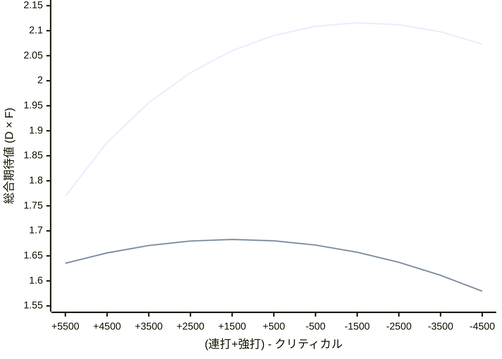

## はじめに（計算式の出典と前提）

マビノギモバイルでは、ステータス画面に「連打強化」「強打強化」「クリティカル」といった能力値が実数値で表示されますが、それらが最終的なダメージにどう影響するかの具体的な計算式はゲーム内では開示されていません。

韓国コミュニティ（DC Inside マビノギモバイルギャラリー）の有志（소쿠쿠氏）により、実機検証を通じた総合ダメージ計算式が整理・公開されています。本記事で使用するダメージ計算式は、すべて以下の検証記事から引用しています。

- **引用元**: [대미지 공식 (26.09.03 이주)](https://gall.dcinside.com/mgallery/board/view/?id=mabinogimobile&no=2171636)

同記事の総合ダメージ計算式において、連打強化や強打強化が属する **「D項（強化系倍率）」** と、クリティカル確率およびクリティカルダメージが属する **「F項（クリティカル倍率）」** は、互いに独立した乗算関係にあります。

$$
\text{ダメージ期待値} \propto D \times F
$$

本記事では、計算をシンプルにするため各項目からステータス基礎部分のみを抜き出し、連打強化・強打強化とクリティカルにステータスポイントを割り振った際の火力期待値の計算方法と、最適な配分バランスの見つけ方について整理します。

---

## 1. 強化系（D項）とクリティカル（F項）の基本計算式

### 1.1 D項（強化系倍率）の計算式

元のダメージ計算式において、連打強化倍率および強打強化倍率はそれぞれ $\left(1 + \dfrac{\text{ステータス}}{8500}\right) \times (1 + \text{該当ダメージ増加\%}) - 1$ として定義されています。

ここでは簡単のため、ルーン等による外部のダメージ増加%補正や他の強化枠（広域・コンボ・究極技）を除外し、基礎となる $\left(1 + \dfrac{\text{ステータス}}{8500}\right)$ の部分のみを抜き出します。

連打強化と強打強化は同じ「D項」の中で**同枠加算**として処理される仕様になっています。したがって、連打と強打が適用される攻撃におけるD項の倍率は以下の式で表されます。

$$
\begin{aligned}
D &= 1 + \text{連打強化倍率} + \text{強打強化倍率} \\
  &= 1 + \frac{\text{連打強化}}{8500} + \frac{\text{強打強化}}{8500} \\
  &= 1 + \frac{\text{連打強化} + \text{強打強化}}{8500}
\end{aligned}
$$

---

### 1.2 F項（クリティカル期待値）の計算式

同様にF項（クリティカル）についても、簡単のため外部のクリティカル率バフやクリティカルダメージ増加%補正を除外し、ステータス数値のみに依存する基礎式を抜き出します。

- **クリティカル確率**:
  $$P = 0.5 - \frac{1}{2 + (\text{クリティカル} / 1000)}$$
- **クリティカル倍率**:
  $$M = 1.4 + \frac{\text{クリティカル}}{5000}$$

非クリティカル時の倍率を $1$ としたとき、クリティカル発生を考慮した **F項の期待値倍率** は以下の式で算出されます。

$$
\begin{aligned}
F &= 1 + P \times (M - 1) \\
  &= 1 + \left(0.5 - \frac{1}{2 + (\text{クリティカル} / 1000)}\right) \times \left(0.4 + \frac{\text{クリティカル}}{5000}\right)
\end{aligned}
$$

> **数式の簡略化に関する補足**:  
> 上記の期待値式を展開して通分すると、確率側の分母に含まれる $(2000 + \text{クリティカル})$ と倍率側の分子が約分されて消去されます。
>
> $$
> P \times (M - 1) = \frac{\text{クリティカル}}{2(2000 + \text{クリティカル})} \times \frac{2000 + \text{クリティカル}}{5000} = \frac{\text{クリティカル}}{10000}
> $$
>
> すなわち、外部補正を除いたF項の期待値は $F = 1 + \dfrac{\text{クリティカル}}{10000}$ という一次式と等価になります。

---

## 2. 具体例による火力期待値（$D \times F$）の比較

上記のD項およびF項の式を用いて、ステータスの合計値が同じ（計 5,500）である2つの配分パターンの期待値を計算し比較します。

### 2.1 例1：連打強化 3,500 / 強打強化 500 / クリティカル 1,500

連打強化と強打強化の合計が $3500 + 500 = 4000$、クリティカルが $1500$ のケースです。

- **D項（強化系倍率）**:
  $$D = 1 + \frac{3500 + 500}{8500} = 1 + \frac{4000}{8500} \approx \mathbf{1.4706}$$
- **F項（クリティカル期待値）**:
  - クリティカル確率: $P = 0.5 - \dfrac{1}{2 + (1500 / 1000)} = 0.5 - \dfrac{1}{3.5} \approx 0.2143\ (21.43\%)$
  - クリティカル倍率: $M = 1.4 + \dfrac{1500}{5000} = 1.70\ (170.0\%)$
  - 期待値倍率: $F = 1 + 0.214286 \times (1.70 - 1) = \mathbf{1.1500}$
- **総合期待値（$D \times F$）**:
  $$D \times F = 1.470588 \times 1.1500 = \mathbf{1.6912}$$

---

### 2.2 例2：連打強化 1,500 / 強打強化 500 / クリティカル 3,500

連打強化と強打強化の合計が $1500 + 500 = 2000$、クリティカルが $3500$ のケースです。

- **D項（強化系倍率）**:
  $$D = 1 + \frac{1500 + 500}{8500} = 1 + \frac{2000}{8500} \approx \mathbf{1.2353}$$
- **F項（クリティカル期待値）**:
  - クリティカル確率: $P = 0.5 - \dfrac{1}{2 + (3500 / 1000)} = 0.5 - \dfrac{1}{5.5} \approx 0.3182\ (31.82\%)$
  - クリティカル倍率: $M = 1.4 + \dfrac{3500}{5000} = 2.10\ (210.0\%)$
  - 期待値倍率: $F = 1 + 0.318182 \times (2.10 - 1) = \mathbf{1.3500}$
- **総合期待値（$D \times F$）**:
  $$D \times F = 1.235294 \times 1.3500 = \mathbf{1.6676}$$

---

### 2.3 2パターンの計算結果まとめ

| パターン | 連打強化 | 強打強化 | クリティカル | D項倍率 | F項期待値 | 総合期待値 ($D \times F$) |
| :--- | :---: | :---: | :---: | :---: | :---: | :---: |
| **例1（連打重視）** | 3,500 | 500 | 1,500 | 1.4706 | 1.1500 | **1.6912** |
| **例2（クリ重視）** | 1,500 | 500 | 3,500 | 1.2353 | 1.3500 | **1.6676** |

同じ合計ポイント（5,500pt）であっても、クリティカルに3,500を振った**後者（例2）の方が総合期待値が低くなる**ことが確認できます。

---

## 3. ステータス +100pt 追加時の倍率変化

なぜ上記の差が生じるのかを分析するため、現在のステータス値 $X$ に対して **100pt を追加したときに倍率がどれだけ変化するか（実質的な火力上昇率）** を数式と表で整理します。

### 3.1 連打強化・強打強化（合計 $X$）に 100pt 追加したときの倍率変化

連打強化と強打強化の合計が $X$ のとき、D項の倍率は $D(X) = 1 + \dfrac{X}{8500}$ です。ここに連打強化を $100$ 追加したときの倍率 $D(X + 100)$ との比（倍率変化）は以下の式で表されます。

$$
\text{倍率比} = \frac{D(X + 100)}{D(X)} = \frac{1 + \dfrac{X + 100}{8500}}{1 + \dfrac{X}{8500}} = \frac{8500 + X + 100}{8500 + X} = 1 + \frac{100}{8500 + X}
$$

$$
\text{100ptあたりの実質上昇率（\%）} = \left(\frac{D(X + 100)}{D(X)} - 1\right) \times 100 = \frac{100}{8500 + X} \times 100
$$

※加算される倍率の絶対差は $\Delta D = \dfrac{100}{8500} \approx +0.01176$ で一定ですが、現在の倍率 $D(X)$ に対する実質的な火力の上昇率は分母 $(8500 + X)$ が大きくなるにつれて緩やかに低下します。

#### D項（連打強化＋強打強化合計 $X$）の 100pt 追加時倍率変化表

| 連打＋強打合計 ($X$) | 現在倍率 $D(X)$ | +100pt後倍率 $D(X+100)$ | 倍率比 $\frac{D(X+100)}{D(X)}$ | 実質上昇率（+100pt時） |
| :---: | :---: | :---: | :---: | :---: |
| **500** | 1.05882 | 1.07059 | 1.01111 | **+1.1111%** |
| **1,000** | 1.11765 | 1.12941 | 1.01053 | **+1.0526%** |
| **1,500** | 1.17647 | 1.18824 | 1.01000 | **+1.0000%** |
| **2,000** | 1.23529 | 1.24706 | 1.00952 | **+0.9524%** |
| **2,500** | 1.29412 | 1.30588 | 1.00909 | **+0.9091%** |
| **3,000** | 1.35294 | 1.36471 | 1.00870 | **+0.8696%** |
| **3,500** | 1.41176 | 1.42353 | 1.00833 | **+0.8333%** |
| **4,000** | 1.47059 | 1.48235 | 1.00800 | **+0.8000%** |
| **4,500** | 1.52941 | 1.54118 | 1.00769 | **+0.7692%** |
| **5,000** | 1.58824 | 1.60000 | 1.00741 | **+0.7407%** |

---

### 3.2 クリティカル（$X$）に 100pt 追加したときの倍率変化

同様に、クリティカルが $X$ のときの期待値倍率は $F(X) = 1 + \left(0.5 - \dfrac{1}{2 + X/1000}\right)\left(0.4 + \dfrac{X}{5000}\right) = 1 + \dfrac{X}{10000}$ です。ここにクリティカルを $100$ 追加したときの倍率 $F(X + 100)$ との比は以下の式で表されます。

$$
\text{倍率比} = \frac{F(X + 100)}{F(X)} = \frac{1 + \dfrac{X + 100}{10000}}{1 + \dfrac{X}{10000}} = \frac{10000 + X + 100}{10000 + X} = 1 + \frac{100}{10000 + X}
$$

$$
\text{100ptあたりの実質上昇率（\%）} = \left(\frac{F(X + 100)}{F(X)} - 1\right) \times 100 = \frac{100}{10000 + X} \times 100
$$

※加算される期待値倍率の絶対差は $\Delta F = \dfrac{100}{10000} = +0.01000$ で一定であり、実質的な火力上昇率は分母 $(10000 + X)$ に反比例して低下します。

#### F項（クリティカル $X$）の 100pt 追加時倍率変化表

| クリティカル ($X$) | クリ確率 $P(X)$ | クリ倍率 $M(X)$ | 現在期待値 $F(X)$ | +100pt後期待値 $F(X+100)$ | 倍率比 $\frac{F(X+100)}{F(X)}$ | 実質上昇率（+100pt時） |
| :---: | :---: | :---: | :---: | :---: | :---: | :---: |
| **500** | 10.00% | 150.0% | 1.05000 | 1.06000 | 1.00952 | **+0.9524%** |
| **1,000** | 16.67% | 160.0% | 1.10000 | 1.11000 | 1.00909 | **+0.9091%** |
| **1,500** | 21.43% | 170.0% | 1.15000 | 1.16000 | 1.00870 | **+0.8696%** |
| **2,000** | 25.00% | 180.0% | 1.20000 | 1.21000 | 1.00833 | **+0.8333%** |
| **2,500** | 27.78% | 190.0% | 1.25000 | 1.26000 | 1.00800 | **+0.8000%** |
| **3,000** | 30.00% | 200.0% | 1.30000 | 1.31000 | 1.00769 | **+0.7692%** |
| **3,500** | 31.82% | 210.0% | 1.35000 | 1.36000 | 1.00741 | **+0.7407%** |
| **4,000** | 33.33% | 220.0% | 1.40000 | 1.41000 | 1.00714 | **+0.7143%** |
| **4,500** | 34.62% | 230.0% | 1.45000 | 1.46000 | 1.00690 | **+0.6897%** |
| **5,000** | 35.71% | 240.0% | 1.50000 | 1.51000 | 1.00667 | **+0.6667%** |

---

## 4. 表から読み解く強弱の理由と最適バランスの見つけ方

### 4.1 なぜ「連打1,500・クリ3,500」の方が弱いのか

第3章の2つの表にある「実質上昇率（+100pt時）」を比較すると、ステータス100ptあたりの基礎的な伸び率は、分母が `8,500` である連打・強打強化（D項）の方が、実質分母が `10,000` であるクリティカル（F項）よりも高いことが分かります。

第2章で比較した2つの例（強打強化500固定）を、表の数値に照らし合わせて確認します。

1. **「連打1,500（＋強打500＝計2,000）・クリ3,500」の状態**:
   - D項の表で $X = 2,000$ を見ると、連打強化に100pt追加したときの上昇率は **`+0.9524%`** です。
   - F項の表で $X = 3,500$ を見ると、クリティカルの100ptあたりの上昇率は **`+0.7407%`** まで低下しています。
   - すなわち、100ptあたり `+0.95%` 伸びる連打強化を放置して、`+0.74%` しか伸びないクリティカルに過剰にポイントを割り振っている状態になっています。
2. **「連打3,500（＋強打500＝計4,000）・クリ1,500」への移行**:
   - クリティカルを $3,500 \rightarrow 1,500$ に減らし、その $2,000\text{pt}$ を連打強化（合計 $2,000 \rightarrow 4,000$）へ移し替えたと考えます。
   - 手放したクリティカル（$1,500 \sim 3,500$ 区間）の100ptあたり上昇率は **`+0.8696% 〜 +0.7407%`** です。
   - 一方、獲得した連打強化（合計 $2,000 \sim 4,000$ 区間）の100ptあたり上昇率は **`+0.9524% 〜 +0.8000%`** であり、すべての区間においてクリティカル側の伸び率を上回っています。

このため、同じポイント数であっても「連打1,500・クリ3,500」より「連打3,500・クリ1,500」の方が高い総合期待値となります。

---

### 4.2 表から最適なステータスバランスを見つける方法

D項とF項は乗算（$D \times F$）であるため、**「D項に100pt振ったときの実質上昇率」と「F項に100pt振ったときの実質上昇率」がちょうど等しくなる地点**が、限られたステータスポイントで最大の火力期待値を得られる最適バランスとなります。

もし片方の上昇率の方が高ければ、上昇率が低い方のステータスを削って高い方へ移すことで、常に総合期待値を引き上げることができるためです。

3.1の表と3.2の表で、**「実質上昇率（+100pt時）」が同じ数値になっている行**を探して並べると、以下の対応関係が見つかります。

| 100ptあたりの実質上昇率 | D項：連打＋強打合計 ($X_D$) | F項：クリティカル ($X_F$) | 両者の差 ($X_D - X_F$) |
| :---: | :---: | :---: | :---: |
| **+0.9524%** | **2,000** | **500** | 1,500 |
| **+0.9091%** | **2,500** | **1,000** | 1,500 |
| **+0.8696%** | **3,000** | **1,500** | 1,500 |
| **+0.8333%** | **3,500** | **2,000** | 1,500 |
| **+0.8000%** | **4,000** | **2,500** | 1,500 |
| **+0.7692%** | **4,500** | **3,000** | 1,500 |
| **+0.7407%** | **5,000** | **3,500** | 1,500 |

表から明らかなように、どの段階においても **「連打強化と強打強化の合計値（$X_D$）が、クリティカル（$X_F$）よりちょうど 1,500 高い状態」** で100ptあたりの上昇率が一致します。

$$
\frac{100}{8500 + X_D} = \frac{100}{10000 + X_F} \iff X_D - X_F = 1500
$$

#### 最適配分の結論

1. **基本ルール**:
   外部バフを除いた基礎ステータス基準では、**「（連打強化 ＋ 強打強化）＝ クリティカル ＋ 1,500」** の差を保つように割り振るのが最も効率の良い配分となります。
   - 連打＋強打の合計が `1,500` に到達するまでは、クリティカルよりも連打（または強打）強化の100ptあたり上昇率が常に上回ります（D項 `1,500` 時点で `+1.0000%` ＞ F項 `0` 時点で `+1.0000%` 未満）。
   - 連打＋強打の合計が `1,500` を超えた後は、**連打（または強打）とクリティカルを 1 : 1 の同じペース**で伸ばしていくことで、常に最適バランスを維持できます。
2. **第2章の例（合計5,500pt、強打500固定）における真の最適解**:
   表の `+0.8333%` の行にあたる **「連打＋強打合計 3,500（連打3,000 / 強打500）・クリティカル 2,000」** が最適バランスとなります。このとき、総合期待値は $D(3500) \times F(2000) = 1.4118 \times 1.2000 = \mathbf{1.6941}$ となり、例1（`1.6912`）や例2（`1.6676`）を上回る最大値となります。

---

## 5. 実戦条件（連打・強打の発動率）を加味した期待値と比較

ここまでの計算では、連打強化と強打強化がすべてのダメージに100%適用される前提で算出してきました。しかし実際の戦闘では、連打判定や強打判定には発動率（全ダメージに対する適用割合）が存在し、100%ではありません。

ここではより実戦に近い条件として、以下の前提を加えて計算し、クリティカルと比較します。

- **連打の発動率**: **$99\%\ (0.99)$**
- **強打の発動率**: **$90\%\ (0.90)$**
- **ステータス振り分け前提**: 強打強化は **$500\text{pt}$ 固定**（一切追加で振らない）とし、ポイントは**連打強化（またはクリティカル）にのみ振り分ける**想定とする。

---

### 5.1 発動率を考慮したD項の期待値計算式

連打強化倍率に発動率 $0.99$、強打強化倍率に発動率 $0.90$ をそれぞれ乗じるため、D項の期待値倍率は以下の式になります。

$$
D = 1 + 0.99 \times \frac{\text{連打強化}}{8500} + 0.90 \times \frac{\text{強打強化}}{8500}
$$

ここで強打強化を $500$（固定）とし、連打強化を $X_{\text{連打}}$（連打＋強打の合計は $X = X_{\text{連打}} + 500$）とおくと、強打500ptによる固定加算分は $0.90 \times \dfrac{500}{8500} = \dfrac{450}{8500}$ となるため、式は以下のように整理されます。

$$
D(X_{\text{連打}}) = 1 + \frac{450 + 0.99 \times X_{\text{連打}}}{8500} \quad \left(\text{合計 } X \text{ 表記では } D(X) = 1 + \frac{0.99 X - 45}{8500}\right)
$$

連打強化に $+100\text{pt}$ を追加したときの倍率比および実質上昇率は、以下の式で表されます。

$$
\text{倍率比} = \frac{D(X_{\text{連打}} + 100)}{D(X_{\text{連打}})} = 1 + \frac{99}{8950 + 0.99 \times X_{\text{連打}}}
$$

$$
\text{100ptあたりの実質上昇率（\%）} = \frac{99}{8950 + 0.99 \times X_{\text{連打}}} \times 100 \approx \frac{100}{9040.4 + X_{\text{連打}}} \times 100
$$

---

### 5.2 発動率考慮時のD項（連打99%・強打90%［500pt固定］）倍率変化表

連打強化を $0 \sim 5,000$（連打＋強打合計 $X = 500 \sim 5,500$）まで500刻みで変化させ、連打強化に $+100\text{pt}$ 追加したときの倍率変化をまとめた表です。

| 連打強化 ($X_{\text{連打}}$) | 連打＋強打合計 ($X$) | 現在期待値 $D$ | +100pt後期待値 | 倍率比 | 実質上昇率（連打+100pt時） |
| :---: | :---: | :---: | :---: | :---: | :---: |
| **0** | **500** | 1.05294 | 1.06459 | 1.01106 | **+1.1061%** |
| **500** | **1,000** | 1.11118 | 1.12282 | 1.01048 | **+1.0482%** |
| **1,000** | **1,500** | 1.16941 | 1.18106 | 1.00996 | **+0.9960%** |
| **1,500** | **2,000** | 1.22765 | 1.23929 | 1.00949 | **+0.9487%** |
| **2,000** | **2,500** | 1.28588 | 1.29753 | 1.00906 | **+0.9058%** |
| **2,500** | **3,000** | 1.34412 | 1.35576 | 1.00867 | **+0.8665%** |
| **3,000** | **3,500** | 1.40235 | 1.41400 | 1.00831 | **+0.8305%** |
| **3,500** | **4,000** | 1.46059 | 1.47224 | 1.00797 | **+0.7974%** |
| **4,000** | **4,500** | 1.51882 | 1.53047 | 1.00767 | **+0.7668%** |
| **4,500** | **5,000** | 1.57706 | 1.58871 | 1.00739 | **+0.7385%** |
| **5,000** | **5,500** | 1.63529 | 1.64694 | 1.00712 | **+0.7122%** |

---

### 5.3 クリティカルとの比較および実戦条件での最適バランス

上記の表（5.2）と、第3章で作成したクリティカルの表（3.2）を比較します。

#### 1. 連打100ptあたりの伸び率とクリティカル100ptあたりの伸び率の照合

5.2の表と3.2の表から、100ptあたりの実質上昇率がほぼ等しくなる行を並べて比較します。

| D項：連打強化 ($X_{\text{連打}}$) | D項：連打＋強打合計 ($X$) | D項の実質上昇率（連打+100pt） | F項：クリティカル ($X_{\text{クリ}}$) | F項の実質上昇率（クリ+100pt） |
| :---: | :---: | :---: | :---: | :---: |
| **1,500** | 2,000 | **+0.9487%** | **500** | **+0.9524%** |
| **2,000** | 2,500 | **+0.9058%** | **1,000** | **+0.9091%** |
| **2,500** | 3,000 | **+0.8665%** | **1,500** | **+0.8696%** |
| **3,000** | 3,500 | **+0.8305%** | **2,000** | **+0.8333%** |
| **3,500** | 4,000 | **+0.7974%** | **2,500** | **+0.8000%** |
| **4,000** | 4,500 | **+0.7668%** | **3,000** | **+0.7692%** |
| **4,500** | 5,000 | **+0.7385%** | **3,500** | **+0.7407%** |
| **5,000** | 5,500 | **+0.7122%** | **4,000** | **+0.7143%** |

発動率が100%から99%（強打は90%）に下がったことで、連打強化100ptあたりの上昇率は3.1の表と比べて約 `0.003%` だけ低下しています。しかし、クリティカルとの対応関係はほとんど変化していません。

両者の上昇率が完全に一致する条件を数式から求めると、以下のようになります。

$$
\frac{99}{8950 + 0.99 \times X_{\text{連打}}} = \frac{100}{10000 + X_{\text{クリ}}} \iff X_{\text{連打}} - X_{\text{クリ}} = 10000 - \frac{8950}{0.99} \approx \mathbf{959.6}
$$

（連打＋強打合計 $X$ との差では $X - X_{\text{クリ}} \approx \mathbf{1,459.6}$ となり、発動率100%時の差 `1,500` から約 `40pt` だけクリティカル寄りにシフトします）

#### 2. 具体例2パターン（合計5,500pt）の再計算結果

発動率（連打99%・強打90%）を適用した状態での例1・例2・最適解の期待値比較は以下の通りです。

| パターン | 連打強化 | 強打強化 | クリティカル | D項期待値 | F項期待値 | 総合期待値 ($D \times F$) |
| :--- | :---: | :---: | :---: | :---: | :---: | :---: |
| **例1（連打3,500）** | 3,500 | 500 | 1,500 | 1.4606 | 1.1500 | **1.6797** |
| **例2（クリ3,500）** | 1,500 | 500 | 3,500 | 1.2276 | 1.3500 | **1.6573** |
| **最適配分（均衡点）** | **2,980** | **500** | **2,020** | **1.4000** | **1.2020** | **1.6828** |

#### まとめ

- 連打発動率99%・強打発動率90%（強打500pt固定）という実戦条件を加味しても、**「連打1,500・クリ3,500」（`1.6573`）より「連打3,500・クリ1,500」（`1.6797`）の方が明確に高い期待値を持つ**という関係は変わりません。
- 強打を500pt固定として連打とクリティカルに振り分ける場合、**「連打強化単体の数値を、クリティカルの数値より約 960（目安として約 1,000）高く保つ」**（例：連打3,000に対してクリティカル2,000、連打4,000に対してクリティカル3,000）ことで、実戦においても期待値が最大化されます。

---

## 6. 「絢爛」ルーン使用時におけるクリティカル期待値と比較

次に、クリティカル関連の代表的なルーンである **「絢爛」** を使用している場合の期待値と倍率変化を算出し、第5章のD項（連打99%・強打90%［500pt固定］）と比較します。

### 6.1 「絢爛」使用時のF項（クリティカル期待値）計算式

「絢爛」ルーンには以下の2つの効果があります。
- **クリティカル発動率**: 別枠で **$+10\%\ (+0.10)$** 加算
- **クリティカル時のダメージ倍率**: 別枠で **$1.3$ 倍** 乗算

これを第1章（1.2）のF項の計算式に組み込むと、クリティカル確率 $P_{\text{絢爛}}$、クリティカル倍率 $M_{\text{絢爛}}$、およびF項の期待値倍率 $F_{\text{絢爛}}$ は以下の式で表されます。

- **クリティカル確率（絢爛）**:
  $$P_{\text{絢爛}}(X) = 0.5 - \frac{1}{2 + (X / 1000)} + 0.10 = 0.6 - \frac{1}{2 + (X / 1000)}$$
- **クリティカル倍率（絢爛）**:
  $$M_{\text{絢爛}}(X) = \left(1.4 + \frac{X}{5000}\right) \times 1.3$$
- **F項の期待値倍率（絢爛）**:
  $$
  \begin{aligned}
  F_{\text{絢爛}}(X) &= 1 + P_{\text{絢爛}}(X) \times (M_{\text{絢爛}}(X) - 1) \\
  &= 1 + \left(0.6 - \frac{1}{2 + (X / 1000)}\right) \times \left(\left(1.4 + \frac{X}{5000}\right) \times 1.3 - 1\right)
  \end{aligned}
  $$

基礎式（絢爛なし）では確率の分母と倍率の分子がちょうど打ち消し合って一次式（$+0.01000 / 100\text{pt}$）になっていましたが、「絢爛」によってクリティカルダメージ全体に $1.3$ 倍が掛かり、さらに確率が $+10\%$ 底上げされることで、**クリティカルステータスを伸ばした際の100ptあたりの伸び幅が大幅に強化**されます。

---

### 6.2 「絢爛」使用時のF項（クリティカル $X$）100pt追加時倍率変化表

クリティカルを $500 \sim 5,000$ まで500刻みで変化させ、クリティカルに $+100\text{pt}$ 追加したときの倍率変化をまとめた表です。

| クリティカル ($X$) | クリ確率 $P_{\text{絢爛}}(X)$ | クリ倍率 $M_{\text{絢爛}}(X)$ | 現在期待値 $F_{\text{絢爛}}(X)$ | +100pt後期待値 $F_{\text{絢爛}}(X+100)$ | 倍率比 $\frac{F(X+100)}{F(X)}$ | 実質上昇率（クリ+100pt時） |
| :---: | :---: | :---: | :---: | :---: | :---: | :---: |
| **500** | 20.00% | 195.0% | 1.19000 | 1.21022 | 1.01699 | **+1.6988%** |
| **1,000** | 26.67% | 208.0% | 1.28800 | 1.30683 | 1.01462 | **+1.4616%** |
| **1,500** | 31.43% | 221.0% | 1.38029 | 1.39827 | 1.01303 | **+1.3027%** |
| **2,000** | 35.00% | 234.0% | 1.46900 | 1.48643 | 1.01186 | **+1.1865%** |
| **2,500** | 37.78% | 247.0% | 1.55533 | 1.57238 | 1.01096 | **+1.0962%** |
| **3,000** | 40.00% | 260.0% | 1.64000 | 1.65678 | 1.01023 | **+1.0230%** |
| **3,500** | 41.82% | 273.0% | 1.72345 | 1.74003 | 1.00962 | **+0.9617%** |
| **4,000** | 43.33% | 286.0% | 1.80600 | 1.82242 | 1.00909 | **+0.9092%** |
| **4,500** | 44.62% | 299.0% | 1.88785 | 1.90415 | 1.00863 | **+0.8634%** |
| **5,000** | 45.71% | 312.0% | 1.96914 | 1.98535 | 1.00823 | **+0.8229%** |

絢爛なし（3.2の表）では $X = 500 \sim 5,000$ の実質上昇率が `+0.9524% 〜 +0.6667%` であったのに対し、絢爛使用時は **`+1.6988% 〜 +0.8229%`** へと全区間において大きく引き上げられていることが確認できます。

---

### 6.3 連打強化（5.2の表）との比較および最適配分の逆転

5.2のD項の表（連打99%・強打90%［500pt固定］）と、6.2のF項の表（絢爛あり）から、**100ptあたりの実質上昇率がほぼ等しくなる行**を照合して並べます。

| D項：連打強化 ($X_{\text{連打}}$) | D項：連打＋強打合計 ($X$) | D項の実質上昇率（連打+100pt） | F項（絢爛）：クリティカル ($X_{\text{クリ}}$) | F項（絢爛）の実質上昇率（クリ+100pt） |
| :---: | :---: | :---: | :---: | :---: |
| **0** | 500 | **+1.1061%** | **2,500** | **+1.0962%** |
| **500** | 1,000 | **+1.0482%** | **3,000** | **+1.0230%** |
| **1,500** | 2,000 | **+0.9487%** | **3,500** | **+0.9617%** |
| **2,000** | 2,500 | **+0.9058%** | **4,000** | **+0.9092%** |
| **2,500** | 3,000 | **+0.8665%** | **4,500** | **+0.8634%** |
| **3,000** | 3,500 | **+0.8305%** | **5,000** | **+0.8229%** |

表を照合すると、絢爛なしの状態とは**優先順位が完全に逆転している**ことが分かります。

1. **クリティカル 2,500 までの優先度**:
   クリティカルが `2,500` に達するまでは、クリティカル100ptあたりの上昇率（`+1.6988% 〜 +1.0962%`）が、連打強化 `0` 時点の上昇率（`+1.1061%`）を常に上回っています。
2. **最適バランスの目安**:
   各段階の均衡点を見ると、**「クリティカルの数値を、連打強化単体の数値より約 2,000（連打＋強打合計より約 1,500）高く保つ」** 状態で100ptあたりの上昇率が一致しています。
   - 連打 `1,500`（`+0.9487%`） ⇔ クリティカル `3,500`（`+0.9617%`）
   - 連打 `2,000`（`+0.9058%`） ⇔ クリティカル `4,000`（`+0.9092%`）
   - 連打 `2,500`（`+0.8665%`） ⇔ クリティカル `4,500`（`+0.8634%`）
   - 連打 `3,000`（`+0.8305%`） ⇔ クリティカル `5,000`（`+0.8229%`）

---

### 6.4 具体例2パターン（合計5,500pt）における評価の逆転

「絢爛」使用時（＋実戦発動率：連打99%・強打90%）において、第2章・第5章で比較した「例1（連打3,500 / クリ1,500）」と「例2（連打1,500 / クリ3,500）」の総合期待値を再計算した結果です。

| パターン | 連打強化 | 強打強化 | クリティカル | D項期待値 | F項期待値（絢爛） | 総合期待値 ($D \times F_{\text{絢爛}}$) |
| :--- | :---: | :---: | :---: | :---: | :---: | :---: |
| **例1（連打3,500）** | 3,500 | 500 | 1,500 | 1.4606 | 1.3803 | **2.0160** |
| **例2（クリ3,500）** | 1,500 | 500 | 3,500 | 1.2276 | 1.7235 | **2.1158** |
| **最適配分（均衡点）** | **1,431** | **500** | **3,569** | **1.2196** | **1.7349** | **2.1159** |

- **優劣の逆転**:
  絢爛なしでは弱かった **「例2（連打1,500 / 強打500 / クリ3,500）」** が、絢爛使用時には総合期待値 **`2.1158`** となり、「例1（連打3,500 / 強打500 / クリ1,500）」（**`2.0160`**）を **約 4.95% 上回る**結果となります。
- **例2がほぼ最適解と一致**:
  6.3の比較表で「連打 `1,500`（`+0.9487%`）⇔ クリティカル `3,500`（`+0.9617%`）」がほぼ均衡している通り、合計5,500pt（強打500固定）における厳密な最適解は「連打 `1,431` / 強打 `500` / クリティカル `3,569`」（期待値 `2.1159`）であり、例2の配分がほぼそのまま最適バランスとなっています。

---

### 6.5 ステータス配分と総合期待値の推移グラフ（合計5,500pt）

合計ポイントを `5,500pt`（うち強打強化は `500pt` 固定、残り `5,000pt` を連打強化とクリティカルに配分）としたとき、ポイントの振り分けによって総合期待値（$D \times F_{\text{絢爛}}$）がどのように変化するかをグラフと表で視覚化します。

#### 1. 折れ線グラフ（横軸：(連打＋強打) － クリティカルの差 / 縦軸：総合期待値）

**【グラフ：「絢爛」あり（上線）と「絢爛」なし（下線）の総合期待値推移（合計5,500pt / 強打500固定）】**

#### 2. ステータス差別の期待値推移・比較バーチャート表

「② 絢爛なし」と「③ 絢爛あり」の期待値推移および最大値に対する相対効率を並べた一覧表です。

| クリティカル | 連打強化 | 連打＋強打合計 | 差（連打強打－クリ） | ②絢爛なし期待値 | ③絢爛あり期待値 | ③最大値比 | ③「絢爛」あり 期待値推移ゲージ |
| :---: | :---: | :---: | :---: | :---: | :---: | :---: | :--- |
| **0** | 5,000 | 5,500 | **+5,500** | 1.6353 | 1.7694 | -16.38% | `██` |
| **500** | 4,500 | 5,000 | **+4,500** | 1.6559 | 1.8767 | -11.30% | `████████` |
| **1,000** | 4,000 | 4,500 | **+3,500** | 1.6707 | 1.9562 | -7.55% | `█████████████` |
| **1,500** | 3,500 | 4,000 | **+2,500** | 1.6797 | **2.0160** | -4.72% | `████████████████` *(例1)* |
| **2,000** | 3,000 | 3,500 | **+1,500** | **1.6828** *(ピーク)* | 2.0601 | -2.64% | `███████████████████` |
| **2,500** | 2,500 | 3,000 | **+500** | 1.6801 | 2.0906 | -1.20% | `█████████████████████` |
| **3,000** | 2,000 | 2,500 | **-500** | 1.6716 | 2.1088 | -0.33% | `██████████████████████` |
| **3,500** | 1,500 | 2,000 | **-1,500** | 1.6573 | **2.1158** *(ピーク)* | **-0.00%** | `███████████████████████` *(例2・最適)* |
| **4,000** | 1,000 | 1,500 | **-2,500** | 1.6372 | 2.1120 | -0.19% | `██████████████████████` |
| **4,500** | 500 | 1,000 | **-3,500** | 1.6112 | 2.0977 | -0.86% | `█████████████████████` |
| **5,000** | 0 | 500 | **-4,500** | 1.5794 | 2.0734 | -2.01% | `████████████████████` |

#### グラフと表から読み取れる特徴

1. **ピーク（頂点）の移動**:
   - **② 絢爛なし**では、左寄りの **「クリティカル 2,000 / 連打 3,000（連打強打－クリ $= +1,500$）」** に山の頂点（`1.6828`）があります。
   - **③ 絢爛あり**では、右寄りの **「クリティカル 3,500 / 連打 1,500（連打強打－クリ $= -1,500$）」** に山の頂点（`2.1158`）が大きく移動します。
2. **曲線の左右非対称性（クリティカル不足時の急落と、3,000〜4,000の高原地帯）**:
   - グラフの曲線を見ると、頂点（クリ3,500）から**左側（クリティカルが低い側）へ外れた場合の落ち込みが非常に急激**であることが分かります（クリ2,000で `-2.64%`、クリ1,500［例1］で `-4.72%`、クリ1,000で `-7.55%` 低下）。
   - 一方で、頂点付近である **クリティカル 3,000 〜 4,000（連打強打－クリの差が $-500 \sim -2,500$）の範囲** はグラフの頂上が緩やかな高原状（プラトー）になっており、この範囲内であれば最大期待値との差は **`0.33%` 以内** に収まります。
   - したがって、「絢爛」使用時はまずクリティカルを `3,000` 以上確保することを最優先とし、その上で「クリティカルが連打強化より約 2,000（連打＋強打合計より約 1,500）高い状態」を目指すのが実践的と言えます。

---

## 7. まとめ

本記事で検証した条件別の最適ステータス配分（強打500pt固定時）の結論は以下の通りです。

| 装備・条件 | 100ptあたりの伸び率の優位性 | 最適バランスの目安（強打500pt固定時） | 合計5,500pt時の最適配分例 |
| :--- | :--- | :--- | :--- |
| **① 基礎状態（発動率100%・絢爛なし）** | 連打・強打強化 ＞ クリティカル | **連打強化 ≒ クリティカル ＋ 1,000**（連打＋強打 ＝ クリ ＋ 1,500） | 連打 **3,000** / 強打 500 / クリ **2,000** |
| **② 実戦発動率（連打99%・強打90%・絢爛なし）** | 連打強化 ＞ クリティカル | **連打強化 ≒ クリティカル ＋ 960**（連打＋強打 ≒ クリ ＋ 1,460） | 連打 **2,980** / 強打 500 / クリ **2,020** |
| **③ 「絢爛」使用時（連打99%・強打90%・絢爛あり）** | **クリティカル ＞ 連打強化** | **クリティカル ≒ 連打強化 ＋ 2,000**（クリ ≒ 連打＋強打 ＋ 1,500） | 連打 **1,500** / 強打 500 / クリ **3,500** |

このように、「絢爛」のようなクリティカル確率とクリティカルダメージ倍率を別枠で大きく引き上げるルーンを装着しているかどうかによって、連打強化とクリティカルの100ptあたりの価値（実質上昇率）が逆転し、目指すべき最適なステータス配分も大きく変化することが数式と表から確認できます。
