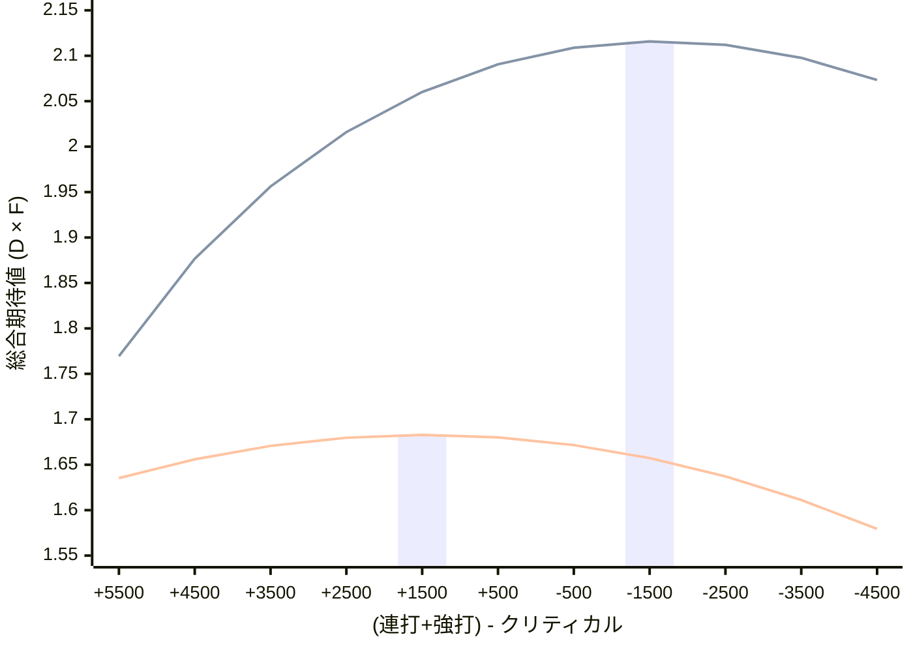

## はじめに（計算式の出典と前提）

マビノギモバイルのステータス画面に表示される「連打強化」「強打強化」「クリティカル」などの実数値が最終ダメージにどう影響するかについて、韓国コミュニティ（DC Inside）の有志（소쿠쿠氏）により総合ダメージ計算式が検証・公開されています。本記事の計算式はすべて以下の記事から引用しています。

- **計算式の引用元**: [대미지 공식 (26.09.03 이주)](https://gall.dcinside.com/mgallery/board/view/?id=mabinogimobile&no=2171636)
- **強打・連打の判定仕様について**: 戦闘中にどのような条件で強打・連打が判定されるかの内部仕様については、[【マビモバ】強打・連打の判定仕様と敵防御力に関する考察](https://york14.github.io/pj_game_archive/posts/mabimoba_smash_judgment_and_rock_giant/) をご参照ください。

総合ダメージ計算式において、連打・強打強化が属する **「D項（強化系倍率）」** と、クリティカルが属する **「F項（クリティカル倍率）」** は独立した乗算関係にあります。

$$
\text{ダメージ期待値} \propto D \times F
$$

本記事では、各項目からステータス基礎部分を抜き出し、連打強化・強打強化とクリティカルにポイントを振った際の火力期待値の計算方法と、両者の最適な配分バランスについて整理します。

> **結論だけ知りたい方はこちら**: [→ 7. まとめ（条件別の最適ステータス配分）へ移動](#7-まとめ)

---

## 1. 強化系（D項）とクリティカル（F項）の基本計算式

### 1.1 D項（強化系倍率）

元の計算式から、簡単のため外部のダメージ増加%補正や他の強化枠（広域・コンボ・究極技）を除き、各ステータスの基礎増加分である $\dfrac{\text{ステータス}}{8500}$（単体倍率 $\left(1 + \dfrac{\text{ステータス}}{8500}\right) - 1$ の部分）を抜き出します。

連打強化と強打強化は同じD項内で**同枠加算**となるため、両方が適用される攻撃のD項は以下の式で表されます。

$$
D = 1 + \frac{\text{連打強化}}{8500} + \frac{\text{強打強化}}{8500} = 1 + \frac{\text{連打強化} + \text{強打強化}}{8500}
$$

---

### 1.2 F項（クリティカル期待値）

同様に外部のクリティカル率バフや推奨戦力ボーナス（レイドHARD等の高難度では0%）、クリティカルダメージ増加%を除き、ステータスのみに依存する基礎式を抜き出します。

- **クリティカル確率**: $P = 0.5 - \dfrac{1}{2 + (\text{クリティカル} / 1000)}$
- **クリティカル倍率**: $M = 1.4 + \dfrac{\text{クリティカル}}{5000}$

非クリティカル時を $1$ としたとき、**F項の期待値倍率**は以下の式で算出されます。

$$
F = 1 + P \times (M - 1) = 1 + \left(0.5 - \frac{1}{2 + (\text{クリティカル} / 1000)}\right) \times \left(0.4 + \frac{\text{クリティカル}}{5000}\right)
$$

> **数式の簡略化**:  
> 上式を通分して整理すると、分母と分子の $(2000 + \text{クリティカル})$ が約分されて消去されます。
>
> $$
> P \times (M - 1) = \frac{\text{クリティカル}}{2(2000 + \text{クリティカル})} \times \frac{2000 + \text{クリティカル}}{5000} = \frac{\text{クリティカル}}{10000}
> $$
>
> すなわち、外部補正を除いたF項の期待値は $F = 1 + \dfrac{\text{クリティカル}}{10000}$ という一次式と等価になります。

---

## 2. 具体例による火力期待値（$D \times F$）の比較

ステータス合計値が同じ（計 5,500pt、うち強打強化は 500pt 固定）である2つの配分パターンで期待値を比較します。

### 2.1 例1：連打＋強打 4,000（連打 3,500 / 強打 500）/ クリティカル 1,500

- **D項**: $D = 1 + \dfrac{3500 + 500}{8500} = 1 + \dfrac{4000}{8500} \approx \mathbf{1.4706}$
- **F項**:
  - 確率 $P = 0.5 - \dfrac{1}{2 + 1.5} \approx 0.2143\ (21.43\%)$、倍率 $M = 1.4 + \dfrac{1500}{5000} = 1.70\ (170.0\%)$
  - 期待値 $F = 1 + 0.2143 \times 0.70 = \mathbf{1.1500}$
- **総合期待値**: $D \times F = 1.4706 \times 1.1500 \approx \mathbf{1.6912}$

### 2.2 例2：連打＋強打 2,000（連打 1,500 / 強打 500）/ クリティカル 3,500

- **D項**: $D = 1 + \dfrac{1500 + 500}{8500} = 1 + \dfrac{2000}{8500} \approx \mathbf{1.2353}$
- **F項**:
  - 確率 $P = 0.5 - \dfrac{1}{2 + 3.5} \approx 0.3182\ (31.82\%)$、倍率 $M = 1.4 + \dfrac{3500}{5000} = 2.10\ (210.0\%)$
  - 期待値 $F = 1 + 0.3182 \times 1.10 = \mathbf{1.3500}$
- **総合期待値**: $D \times F = 1.2353 \times 1.3500 \approx \mathbf{1.6676}$

### 2.3 計算結果の比較（強打500固定）

| パターン | 連打＋強打 | クリ | D項 | F項 | 総合期待値 ($D \times F$) |
| :--- | :---: | :---: | :---: | :---: | :---: |
| **例1（連打＋強打重視）** | 4,000 | 1,500 | 1.4706 | 1.1500 | **1.6912** |
| **例2（クリ重視）** | 2,000 | 3,500 | 1.2353 | 1.3500 | **1.6676** |

同じ合計ポイントであっても、クリティカルに多く振った**例2の方が総合期待値が低くなる**ことが確認できます。

---

## 3. ステータス +100pt 追加時の倍率変化

現在のステータス値 $X$ に対して **100pt 追加したときの実質的な倍率上昇率（以下、+100pt上昇率）** を数式と表で整理します。

### 3.1 連打・強打強化（合計 $X$）に +100pt したときの変化

連打強化と強打強化の合計が $X$ のとき、$100\text{pt}$ 追加した際の倍率比 $\dfrac{D(X+100)}{D(X)}$ および+100pt上昇率は以下の式で表されます（※表の上昇率は百分率 `%` で表記）。

$$
\frac{D(X + 100)}{D(X)} = \frac{1 + \dfrac{X + 100}{8500}}{1 + \dfrac{X}{8500}} = 1 + \frac{100}{8500 + X} \quad \left(\text{+100pt上昇率} = \frac{100}{8500 + X} \times 100\%\right)
$$

※加算される絶対差は $\Delta D = \dfrac{100}{8500} \approx +0.01176$ で一定ですが、現在の倍率に対する+100pt上昇率は $X$ が増えるほど低下します。

| 連打＋強打 ($X$) | 倍率 $D(X)$ | +100pt上昇率 |
| :---: | :---: | :---: |
| **500** | 1.0588 | **+1.1111%** |
| **1,000** | 1.1176 | **+1.0526%** |
| **1,500** | 1.1765 | **+1.0000%** |
| **2,000** | 1.2353 | **+0.9524%** |
| **2,500** | 1.2941 | **+0.9091%** |
| **3,000** | 1.3529 | **+0.8696%** |
| **3,500** | 1.4118 | **+0.8333%** |
| **4,000** | 1.4706 | **+0.8000%** |
| **4,500** | 1.5294 | **+0.7692%** |
| **5,000** | 1.5882 | **+0.7407%** |

---

### 3.2 クリティカル（$X$）に +100pt したときの変化

クリティカルが $X$ のとき、期待値は $F(X) = 1 + \dfrac{X}{10000}$ であるため、$100\text{pt}$ 追加した際の倍率比および+100pt上昇率は以下となります。

$$
\frac{F(X + 100)}{F(X)} = \frac{1 + \dfrac{X + 100}{10000}}{1 + \dfrac{X}{10000}} = 1 + \frac{100}{10000 + X} \quad \left(\text{+100pt上昇率} = \frac{100}{10000 + X} \times 100\%\right)
$$

| クリティカル ($X$) | 確率 $P$ | 倍率 $M$ | 期待値 $F(X)$ | +100pt上昇率 |
| :---: | :---: | :---: | :---: | :---: |
| **500** | 10.00% | 150.0% | 1.0500 | **+0.9524%** |
| **1,000** | 16.67% | 160.0% | 1.1000 | **+0.9091%** |
| **1,500** | 21.43% | 170.0% | 1.1500 | **+0.8696%** |
| **2,000** | 25.00% | 180.0% | 1.2000 | **+0.8333%** |
| **2,500** | 27.78% | 190.0% | 1.2500 | **+0.8000%** |
| **3,000** | 30.00% | 200.0% | 1.3000 | **+0.7692%** |
| **3,500** | 31.82% | 210.0% | 1.3500 | **+0.7407%** |
| **4,000** | 33.33% | 220.0% | 1.4000 | **+0.7143%** |
| **4,500** | 34.62% | 230.0% | 1.4500 | **+0.6897%** |
| **5,000** | 35.71% | 240.0% | 1.5000 | **+0.6667%** |

---

## 4. 表から読み解く強弱の理由と最適バランス

### 4.1 なぜ「連打＋強打 2,000 / クリ 3,500」の方が弱いのか

3.1と3.2の表を比較すると、基礎の+100pt上昇率は分母が `8,500` の連打＋強打（D項）の方が、実質分母が `10,000` のクリティカル（F項）より高くなっています。

- **例2（連打＋強打 2,000 / クリ 3,500）の状態**:
  表を見ると、連打＋強打 `2,000` の+100pt上昇率は **`+0.9524%`** であるのに対し、クリティカル `3,500` の+100pt上昇率は **`+0.7407%`** まで落ち込んでいます。
- **例1（連打＋強打 4,000 / クリ 1,500）との差**:
  クリティカルを `3,500 → 1,500` に減らして手放す上昇率（`+0.8696% 〜 +0.7407%`）よりも、その2,000ptを連打＋強打（`2,000 → 4,000`）に振って得られる上昇率（`+0.9524% 〜 +0.8000%`）の方が全区間で上回っているため、例1の方が強くなります。

---

### 4.2 表から最適なステータスバランスを見つける方法

D項とF項は乗算（$D \times F$）であるため、**「両者の+100pt上昇率が等しくなる地点」** が合計ポイント一定の条件下で期待値が最大となる最適バランスです。

3.1と3.2の表で「+100pt上昇率」が一致する行を並べると、以下の対応関係が得られます。

| +100pt上昇率 | 連打＋強打 ($X_D$) | クリティカル ($X_F$) | 差 ($X_D - X_F$) |
| :---: | :---: | :---: | :---: |
| **+0.9524%** | **2,000** | **500** | 1,500 |
| **+0.9091%** | **2,500** | **1,000** | 1,500 |
| **+0.8696%** | **3,000** | **1,500** | 1,500 |
| **+0.8333%** | **3,500** | **2,000** | 1,500 |
| **+0.8000%** | **4,000** | **2,500** | 1,500 |
| **+0.7692%** | **4,500** | **3,000** | 1,500 |
| **+0.7407%** | **5,000** | **3,500** | 1,500 |

どの段階でも **「連打＋強打の合計（$X_D$）が、クリティカル（$X_F$）より 1,500 高い状態」**（$\dfrac{100}{8500 + X_D} = \dfrac{100}{10000 + X_F} \iff X_D - X_F = 1500$）で上昇率が一致します。

- **最適配分の結論**: 連打＋強打が「クリティカル ＋ 1,500」に達するまでは連打・強打を優先し、以降は **1 : 1 のペース**で伸ばすのが最適です。第2章の条件（計5,500pt、強打500固定）では **「連打＋強打 3,500（連打 3,000 / 強打 500）/ クリ 2,000」**（上昇率 `+0.8333%` で均衡）が最適解となり、期待値は最大の **`1.6941`** となります。

---

## 5. 実戦条件（連打・強打の発動率）を加味した比較

実際の戦闘では連打や強打の発動率は100%ではありません。ここでは以下の実戦想定条件を加えて比較します。

- **発動率の仮定**: 連打 **$99\%\ (0.99)$**、強打 **$90\%\ (0.90)$**
- **振り分け前提**: 強打強化は **$500\text{pt}$ 固定**とし、ポイントは連打強化（またはクリティカル）にのみ振る。

### 5.1 発動率考慮時のD項計算式と倍率変化表

連打＋強打の合計を $X$（うち強打 $500$ 固定、連打 $X - 500$）とすると、D項の期待値および連打に $+100\text{pt}$ 追加した際の上昇率は以下となります。

$$
D(X) = 1 + 0.99 \times \frac{X - 500}{8500} + 0.90 \times \frac{500}{8500} = 1 + \frac{0.99 X - 45}{8500} \quad \left(\text{+100pt上昇率} = \frac{99}{8455 + 0.99 X} \times 100\%\right)
$$

| 連打＋強打 ($X$) | 期待値 $D(X)$ | +100pt上昇率 |
| :---: | :---: | :---: |
| **500** | 1.0529 | **+1.1061%** |
| **1,000** | 1.1112 | **+1.0482%** |
| **1,500** | 1.1694 | **+0.9960%** |
| **2,000** | 1.2276 | **+0.9487%** |
| **2,500** | 1.2859 | **+0.9058%** |
| **3,000** | 1.3441 | **+0.8665%** |
| **3,500** | 1.4024 | **+0.8305%** |
| **4,000** | 1.4606 | **+0.7974%** |
| **4,500** | 1.5188 | **+0.7668%** |
| **5,000** | 1.5771 | **+0.7385%** |
| **5,500** | 1.6353 | **+0.7122%** |

---

### 5.2 クリティカル（3.2表）との比較と最適バランス

上表（5.1）とクリティカルの表（3.2）で、+100pt上昇率がほぼ等しくなる行を照合します。

| 連打＋強打 ($X_D$) | D項 +100pt上昇率 | クリティカル ($X_F$) | F項 +100pt上昇率 |
| :---: | :---: | :---: | :---: |
| **2,000** | **+0.9487%** | **500** | **+0.9524%** |
| **2,500** | **+0.9058%** | **1,000** | **+0.9091%** |
| **3,000** | **+0.8665%** | **1,500** | **+0.8696%** |
| **3,500** | **+0.8305%** | **2,000** | **+0.8333%** |
| **4,000** | **+0.7974%** | **2,500** | **+0.8000%** |
| **4,500** | **+0.7668%** | **3,000** | **+0.7692%** |
| **5,000** | **+0.7385%** | **3,500** | **+0.7407%** |
| **5,500** | **+0.7122%** | **4,000** | **+0.7143%** |

発動率を考慮しても上昇率は約 `0.003%` 低下するだけで、対応関係はほぼ変わりません。厳密な均衡条件は $X_D - X_F = 10000 - \dfrac{8455}{0.99} \approx \mathbf{1,459.6}$ となり、**「連打強化＋強打強化の合計を、クリティカルより約 1,460（目安として約 1,500）高く保つ」**のが最適となります。

#### 合計5,500pt（強打500固定）の再計算結果

| パターン | 連打＋強打 | クリ | D項 | F項 | 総合期待値 ($D \times F$) |
| :--- | :---: | :---: | :---: | :---: | :---: |
| **例1（連打＋強打重視）** | 4,000 | 1,500 | 1.4606 | 1.1500 | **1.6797** |
| **例2（クリ重視）** | 2,000 | 3,500 | 1.2276 | 1.3500 | **1.6573** |
| **最適配分（均衡点）** | **3,480** | **2,020** | **1.4000** | **1.2020** | **1.6828** |

---

## 6. 「絢爛」ルーン使用時における期待値と最適配分の逆転

次に、クリティカル発動率が別枠で **$+10\%$** され、クリティカル時のダメージが別枠で **$1.3$倍** されるルーン **「絢爛」** を使用している場合を比較します。

### 6.1 「絢爛」使用時のF項計算式と倍率変化表

- **クリティカル確率**: $P_{\text{絢爛}}(X) = 0.6 - \dfrac{1}{2 + (X / 1000)}$
- **クリティカル倍率**: $M_{\text{絢爛}}(X) = \left(1.4 + \dfrac{X}{5000}\right) \times 1.3$
- **F項期待値**: $F_{\text{絢爛}}(X) = 1 + P_{\text{絢爛}}(X) \times (M_{\text{絢爛}}(X) - 1)$

クリティカルダメージ全体に $1.3$ 倍が掛かり、さらに確率が $+10\%$ 底上げされることで、クリティカルの+100pt上昇率が大幅に強化されます。

| クリティカル ($X$) | 確率 $P$ | 倍率 $M$ | 期待値 $F_{\text{絢爛}}(X)$ | +100pt上昇率 |
| :---: | :---: | :---: | :---: | :---: |
| **500** | 20.00% | 195.0% | 1.1900 | **+1.6988%** |
| **1,000** | 26.67% | 208.0% | 1.2880 | **+1.4616%** |
| **1,500** | 31.43% | 221.0% | 1.3803 | **+1.3027%** |
| **2,000** | 35.00% | 234.0% | 1.4690 | **+1.1865%** |
| **2,500** | 37.78% | 247.0% | 1.5553 | **+1.0962%** |
| **3,000** | 40.00% | 260.0% | 1.6400 | **+1.0230%** |
| **3,500** | 41.82% | 273.0% | 1.7235 | **+0.9617%** |
| **4,000** | 43.33% | 286.0% | 1.8060 | **+0.9092%** |
| **4,500** | 44.62% | 299.0% | 1.8878 | **+0.8634%** |
| **5,000** | 45.71% | 312.0% | 1.9691 | **+0.8229%** |

---

### 6.2 連打・強打強化（5.1表）との比較および最適配分の逆転

5.1のD項の表（連打99%・強打90%［500pt固定］）と、6.1のF項の表（絢爛あり）から、+100pt上昇率がほぼ等しくなる行を照合します。

| 連打＋強打 ($X_D$) | D項 +100pt上昇率 | クリティカル ($X_F$) | F項 +100pt上昇率 (絢爛) |
| :---: | :---: | :---: | :---: |
| **500** | **+1.1061%** | **2,500** | **+1.0962%** |
| **1,000** | **+1.0482%** | **3,000** | **+1.0230%** |
| **2,000** | **+0.9487%** | **3,500** | **+0.9617%** |
| **2,500** | **+0.9058%** | **4,000** | **+0.9092%** |
| **3,000** | **+0.8665%** | **4,500** | **+0.8634%** |
| **3,500** | **+0.8305%** | **5,000** | **+0.8229%** |

絢爛使用時のF項は非線形のため合計ポイントによって均衡差はわずかに変動しますが、このステータス帯では絢爛なしの状態と優先順位が逆転し、**「連打強化＋強打強化の合計を、クリティカルより約 1,500 低く保つ（クリティカルを連打＋強打合計より約 1,500 高く保つ）」** 状態で+100pt上昇率がほぼ一致します。

#### 合計5,500pt（強打500固定）における評価の逆転

| パターン | 連打＋強打 | クリ | D項 | F項 (絢爛) | 総合期待値 ($D \times F_{\text{絢爛}}$) |
| :--- | :---: | :---: | :---: | :---: | :---: |
| **例1（連打＋強打重視）** | 4,000 | 1,500 | 1.4606 | 1.3803 | **2.0160** |
| **例2（クリ重視）** | 2,000 | 3,500 | 1.2276 | 1.7235 | **2.1158** |
| **最適配分（均衡点）** | **1,931** | **3,569** | **1.2196** | **1.7349** | **2.1159** |

絢爛なしでは弱かった **「例2（連打＋強打 2,000 / クリ 3,500）」** が、絢爛使用時にはほぼ最適解そのものとなり、例1（`2.0160`）を **約 4.95% 上回る**結果となります。

---

### 6.3 ステータス配分と総合期待値の推移グラフ（合計5,500pt）

合計 `5,500pt`（うち強打 `500pt` 固定）において、横軸に `(連打＋強打) - クリティカル` の差、縦軸に総合期待値をとった推移グラフです。

**【グラフ：「絢爛」あり（上線）と「絢爛」なし（下線）の総合期待値推移】**

- **ピーク位置の移動**: 絢爛なし（下線）では `+1500`（連打＋強打 3,500 / クリ 2,000）が頂点（`1.6828`）ですが、絢爛あり（上線）では **`-1500`（連打＋強打 2,000 / クリ 3,500）** へ頂点（`2.1158`）が大きく移動します。
- **クリティカル不足時の急落**: 絢爛あり（上線）では、頂点である `-1500`（クリ 3,500）より左側（クリティカルが低い側）に外れると期待値が急激に低下します。一方、`-500 〜 -2500`（クリ 3,000〜4,000）の範囲は頂上が緩やかで、最大値との差が `0.33%` 以内に収まります。

---

## 7. まとめ

本記事で検証した条件別の最適ステータス配分（強打500pt固定時）の結論は以下の通りです。

| 条件（強打500固定） | 最適バランスの目安 | 合計5,500pt時の最適配分（目安） |
| :--- | :--- | :--- |
| **基礎状態** （発動率100%・絢爛なし） | **連打＋強打 ＝ クリ ＋ 1,500** | 連打＋強打 **3,500** / クリ **2,000** |
| **実戦発動率** （連打99%・強打90%・絢爛なし） | **連打＋強打 ≒ クリ ＋ 1,460** （目安：**クリ ＋ 1,500**） | 連打＋強打 **3,480** / クリ **2,020** （目安：**3,500** / **2,000**） |
| **「絢爛」使用時** （連打99%・強打90%・絢爛あり） | **連打＋強打 ≒ クリ － 1,500** （**クリ ≒ 連打＋強打 ＋ 1,500**） | 連打＋強打 **1,931** / クリ **3,569** （目安：**2,000** / **3,500**） |

「絢爛」のようにクリティカル確率とクリティカルダメージ倍率を別枠で引き上げるルーンの有無によって、連打＋強打とクリティカルの+100pt上昇率が逆転し、最適なステータス配分が大きく変化することが確認できます。
